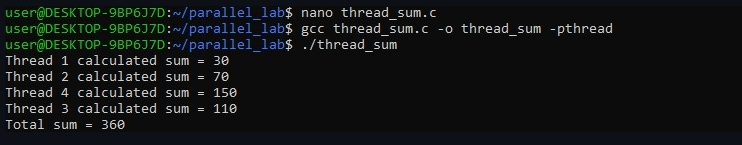
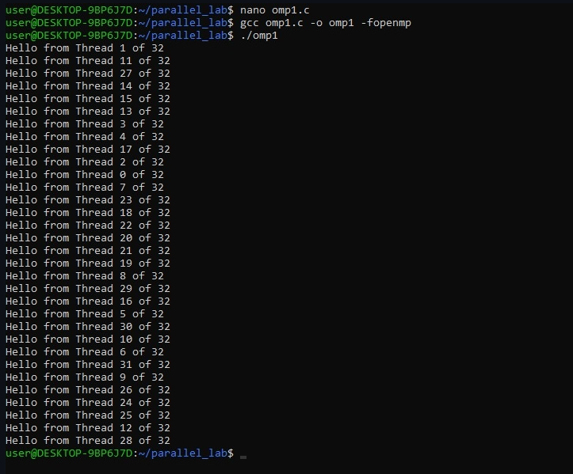
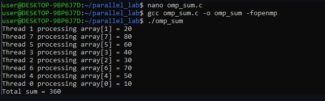
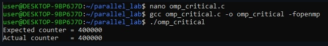
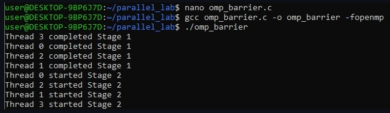
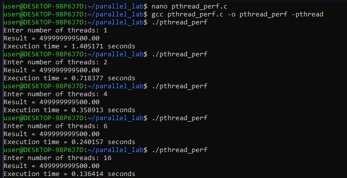
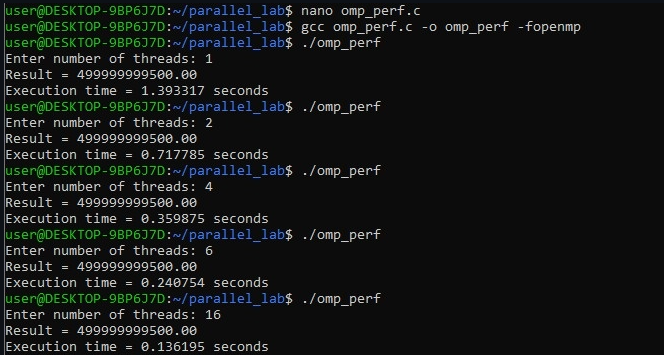
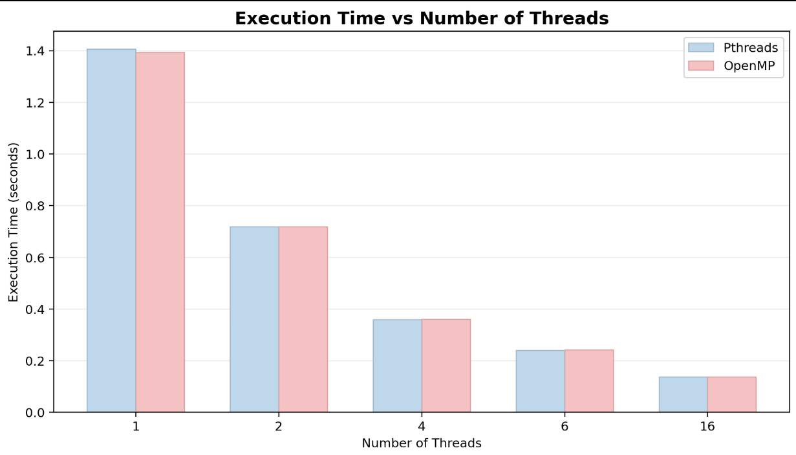
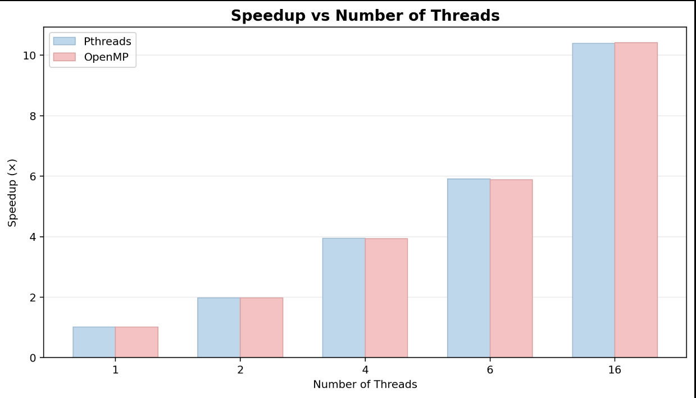
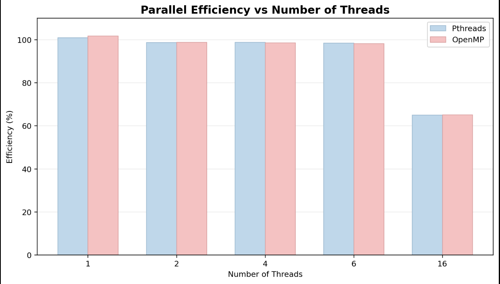

# PGC-02: Multithreaded Programming Using Pthreads and OpenMP

**Course:** Parallel and GPU Computing (PGC)
**Experiment:** 02 — Multithreaded Programming
**Topic:** Thread Creation, Work Distribution, Synchronization and Performance Analysis

---

## 1. Experiment Overview

This experiment demonstrates **multithreaded programming in C** using two shared-memory parallel programming approaches:

* **POSIX Threads (Pthreads)** — explicit thread creation and synchronization.
* **OpenMP** — compiler directives and runtime-managed parallel execution.

The experiment begins with basic thread creation and gradually introduces work distribution, race conditions, synchronization, barriers, and performance analysis.

The final part compares **sequential execution, Pthreads, and OpenMP** using a large computational workload and analyzes execution time, speedup, parallel efficiency, and scalability.

---

## 2. Objectives

The main objectives of this experiment are:

1. Understand how threads are created and managed.
2. Learn how a workload can be divided among multiple threads.
3. Demonstrate shared-memory access and concurrency.
4. Identify race conditions caused by unsynchronized shared data.
5. Use mutexes and OpenMP critical sections for mutual exclusion.
6. Understand barrier synchronization between execution phases.
7. Use OpenMP reduction for safely combining partial results.
8. Measure execution time for different thread counts.
9. Calculate speedup and parallel efficiency.
10. Compare Pthreads and OpenMP from both programming and performance perspectives.

---

## 3. Multithreading Concept

A **thread** is an independent flow of execution within a process. Threads belonging to the same process share the process's memory space, making communication efficient.

A sequential program executes its work through a single execution stream:

```text
Sequential Execution

Main Thread → Task 1 → Task 2 → Task 3 → Task 4 → Finish
```

A multithreaded program can divide the workload among multiple workers:

```text
                         ┌── Thread 1 → Work 1 ──┐
                         ├── Thread 2 → Work 2 ──┤
Main Thread → Spawn ─────┼── Thread 3 → Work 3 ──┼── Join → Result
                         └── Thread 4 → Work 4 ──┘
```

The actual performance improvement depends on factors such as CPU resources, memory bandwidth, cache behavior, thread-management overhead, synchronization, and operating-system scheduling.

---

## 4. System and Software Environment

| Component                  | Configuration                          |
| -------------------------- | -------------------------------------- |
| Operating System           | Windows 11 with WSL — Ubuntu           |
| Compiler                   | GCC 15.2.0                             |
| Compiler Version           | `gcc (Ubuntu 15.2.0-16ubuntu1) 15.2.0` |
| Pthreads Flag              | `-pthread`                             |
| OpenMP Flag                | `-fopenmp`                             |
| Optimization               | `-O2`                                  |
| Parallel Hardware Capacity | 32 logical threads                     |

### Environment Verification

The WSL environment was prepared and the compiler capabilities were verified using:

```bash
wsl

mkdir -p ~/parallel_lab
cd ~/parallel_lab

gcc --version
gcc -fopenmp --version
```

The compiler version confirms GCC availability, while the OpenMP check verifies support for OpenMP compilation.


---

# 5. Part A — POSIX Threads (Pthreads)

**POSIX Threads (Pthreads)** provides a low-level programming interface for creating and managing threads.

Unlike OpenMP, where the runtime manages much of the thread infrastructure, Pthreads requires the programmer to explicitly handle thread creation, arguments, synchronization, and joining.

Important functions used in this experiment include:

* `pthread_create()` — creates a thread.
* `pthread_join()` — waits for a thread to finish.
* `pthread_mutex_lock()` — acquires a mutex.
* `pthread_mutex_unlock()` — releases a mutex.

---

## 5.1 Single Thread Creation

**Source:** [`thread1.c`](./pthreads/thread1.c)

### Concept

The program creates one worker thread. The main thread waits for the worker to complete using `pthread_join()`.

### Compile and Run

```bash
cd ~/parallel_lab/pthreads

gcc thread1.c -o thread1 -pthread
./thread1
```

This experiment introduces the basic lifecycle of a Pthread: **create → execute → join**.


---

## 5.2 Multiple Thread Creation

**Source:** [`thread2.c`](./pthreads/thread2.c)

### Concept

Four worker threads are created using a loop. Each thread receives an identifier so that its execution can be distinguished.

### Compile and Run

```bash
gcc thread2.c -o thread2 -pthread
./thread2
```

The output order is not guaranteed. For example:

```text
1 → 3 → 2 → 4
```

may be observed in one execution, while another execution may produce a different order.

This occurs because thread scheduling is controlled by the operating system.


---

## 5.3 Work Distribution and Array Chunking

**Source:** [`thread_sum.c`](./pthreads/thread_sum.c)

### Concept

The program processes the following 8-element array:

```text
[10, 20, 30, 40, 50, 60, 70, 80]
```

Four threads are used, with each thread processing two elements.

The partial sums are:

```text
Thread 1 → 10 + 20 = 30
Thread 2 → 30 + 40 = 70
Thread 3 → 50 + 60 = 110
Thread 4 → 70 + 80 = 150
```

Therefore:

```text
Total = 30 + 70 + 110 + 150
      = 360
```

### Compile and Run

```bash
gcc thread_sum.c -o thread_sum -pthread
./thread_sum
```

This demonstrates **static work distribution**, where the programmer explicitly determines the portion of the array processed by each thread.



---

## 5.4 Race Condition

**Source:** [`race.c`](./pthreads/race.c)

### Concept

Four threads increment a shared global variable `counter` 100,000 times each.

The expected result is:

```text
4 × 100000 = 400000
```

However, the program can produce a smaller value because multiple threads access and modify the same variable without synchronization.

The statement:

```c
counter++;
```

involves multiple conceptual operations:

1. Read the current value.
2. Add one.
3. Write the updated value.

If two threads read the same value before either writes its result, one update can overwrite the other.

This produces **lost updates**.

In the recorded execution:

```text
Expected updates = 400000
Lost updates      = 262410
```

This demonstrates the effect of a race condition on shared data.

### Compile and Run

```bash
gcc race.c -o race -pthread
./race
```


---

## 5.5 Mutual Exclusion Using a Mutex

**Source:** [`mutex.c`](./pthreads/mutex.c)

### Concept

The race condition is corrected by protecting the shared counter with a POSIX mutex.

The critical operation is protected using:

```c
pthread_mutex_lock(&lock);

counter++;

pthread_mutex_unlock(&lock);
```

Only one thread can execute the protected section at a time.

The expected result is therefore obtained:

```text
400000
```

### Compile and Run

```bash
gcc mutex.c -o mutex -pthread
./mutex
```

The mutex demonstrates **mutual exclusion**, where concurrent threads are prevented from modifying the shared resource simultaneously.


---

# 6. Part B — OpenMP

**OpenMP (Open Multi-Processing)** provides a higher-level approach to shared-memory parallel programming.

Instead of manually creating and joining individual threads, the programmer can use compiler directives such as:

```c
#pragma omp parallel
```

and:

```c
#pragma omp parallel for
```

The OpenMP runtime manages the thread team and much of the associated execution.

---

## 6.1 OpenMP Parallel Region

**Source:** [`omp1.c`](./openmp/omp1.c)

### Concept

A parallel region is created using:

```c
#pragma omp parallel
```

Each thread can identify itself using:

```c
omp_get_thread_num()
```

and the total number of threads can be obtained using:

```c
omp_get_num_threads()
```

### Compile and Run

```bash
cd ~/parallel_lab/openmp

gcc omp1.c -o omp1 -fopenmp
./omp1
```

The experiment demonstrates how multiple threads participate in the same parallel region.



---

## 6.2 Work Sharing and Reduction

**Source:** [`omp_sum.c`](./openmp/omp_sum.c)

### Concept

The loop is parallelized using:

```c
#pragma omp parallel for
```

A reduction operation is used to safely combine the partial sums:

```c
reduction(+:total_sum)
```

Each thread maintains its own partial result, and OpenMP combines those results at the end.

This avoids multiple threads directly updating the same accumulator.

### Compile and Run

```bash
gcc omp_sum.c -o omp_sum -fopenmp
./omp_sum
```



---

## 6.3 OpenMP Race Condition

**Source:** [`omp_race.c`](./openmp/omp_race.c)

### Concept

OpenMP does not automatically make every shared-data operation safe.

Four threads perform 100,000 increments each.

Expected result:

```text
400000
```

Because the shared accumulator is modified without synchronization, updates can be lost.

In the recorded execution:

```text
Expected updates = 400000
Dropped updates  = 299825
```

### Compile and Run

```bash
gcc omp_race.c -o omp_race -fopenmp
./omp_race
```


---

## 6.4 OpenMP Critical Section

**Source:** [`omp_critical.c`](./openmp/omp_critical.c)

### Concept

The race condition is corrected using:

```c
#pragma omp critical
```

Only one thread at a time can execute the protected section.

The resulting counter is:

```text
400000
```

### Compile and Run

```bash
gcc omp_critical.c -o omp_critical -fopenmp
./omp_critical
```

A critical section provides synchronization, although excessive use can reduce parallel performance because threads may spend time waiting.



---

## 6.5 Barrier Synchronization

**Source:** [`omp_barrier.c`](./openmp/omp_barrier.c)

### Concept

A barrier forces all participating threads to reach the same synchronization point before any of them continue.

The directive used is:

```c
#pragma omp barrier
```

The experiment contains multiple execution stages.

The important observation is:

```text
All threads complete Stage 1
             ↓
       Barrier reached
             ↓
All threads proceed to Stage 2
```

### Compile and Run

```bash
gcc omp_barrier.c -o omp_barrier -fopenmp
./omp_barrier
```

Barriers are useful when a later phase depends on the completion of an earlier phase.



---

# 7. Part C — Performance Analysis

The final part evaluates the scalability of sequential, Pthreads, and OpenMP implementations.

A compute-intensive workload of:

```text
N = 1,000,000,000 iterations
  = 10^9 iterations
```

is used.

The same mathematical computation is performed by all three implementations.

## Mathematical Invariant

The expected mathematical result is:

```text
499999999500.00
```

This invariant is used to verify that the parallel implementations produce the same computational result as the sequential implementation.

---

## 7.1 Sequential Baseline

**Source:** [`sequential.c`](./performance/sequential.c)

### Compile and Run

```bash
cd ~/parallel_lab/performance

gcc sequential.c -o sequential_program
./sequential_program
```

Recorded baseline execution time:

```text
Tseq = 1.418018 seconds
```

This value is used as the reference for calculating speedup.


---

## 7.2 Pthreads Performance

**Source:** [`pthread_perf.c`](./performance/pthread_perf.c)

The Pthreads implementation was tested using:

```text
1, 2, 4, 6, and 16 threads
```

### Compile and Run

```bash
gcc pthread_perf.c -o pthread_perf -pthread
./pthread_perf
```



---

## 7.3 OpenMP Performance

**Source:** [`omp_perf.c`](./performance/omp_perf.c)

The OpenMP implementation uses the same workload and the same thread counts:

```text
1, 2, 4, 6, and 16 threads
```

### Compile and Run

```bash
gcc omp_perf.c -o omp_perf -fopenmp
./omp_perf
```



---

# 8. Execution Time Comparison

The measured execution times are:

| Threads | Sequential Baseline |       Pthreads |         OpenMP | Time Reduction vs Sequential |
| ------: | ------------------: | -------------: | -------------: | ---------------------------: |
|       1 |          1.418018 s | **1.405171 s** | **1.393317 s** |                        ~1.7% |
|       2 |                   — | **0.718377 s** | **0.717785 s** |                       ~49.4% |
|       4 |                   — | **0.358913 s** | **0.359875 s** |                       ~74.7% |
|       6 |                   — | **0.240157 s** | **0.240754 s** |                   **~83.1%** |
|      16 |                   — | **0.136414 s** | **0.136195 s** |                   **~90.4%** |

### Observation

Execution time decreases as the number of threads increases.

Pthreads and OpenMP produce very similar execution times for this workload. This indicates that both approaches can effectively utilize shared-memory CPU resources.

At higher thread counts, however, the improvement becomes less than perfectly linear.



---

# 9. Speedup Analysis

Speedup measures how much faster a parallel implementation is compared with the sequential baseline.

The formula is:

```text
Speedup (S) = Tsequential / Tparallel
```

The measured speedups are:

| Threads | Pthreads Speedup | OpenMP Speedup | Scaling Assessment                                   |
| ------: | ---------------: | -------------: | ---------------------------------------------------- |
|       1 |       **1.009×** |     **1.018×** | Single-core baseline                                 |
|       2 |       **1.974×** |     **1.976×** | Near-linear dual-core speedup (~2×)                  |
|       4 |       **3.951×** |     **3.940×** | Near-linear quad-core speedup (~4×)                  |
|       6 |       **5.905×** |     **5.890×** | Near-linear six-thread scaling                       |
|      16 |      **10.395×** |    **10.412×** | High parallel throughput with reduced linear scaling |

The results show strong scaling from 1 to 6 threads.

At 16 threads, the speedup continues to increase but does not reach the theoretical ideal of 16×.



---

# 10. Parallel Efficiency

Parallel efficiency measures how close the measured speedup is to ideal linear scaling.

```text
Efficiency (E) = Speedup / P × 100%
```

The measured efficiencies are:

| Threads | Pthreads Efficiency | OpenMP Efficiency | Operating State                                          |
| ------: | ------------------: | ----------------: | -------------------------------------------------------- |
|       1 |         **100.91%** |       **101.77%** | Single-thread baseline                                   |
|       2 |          **98.70%** |        **98.78%** | Very high efficiency (~99%)                              |
|       4 |          **98.77%** |        **98.51%** | Near-optimal multicore scaling                           |
|       6 |          **98.41%** |        **98.16%** | High sustained utilization                               |
|      16 |          **64.97%** |        **65.07%** | Reduced efficiency due to hardware and parallel overhead |

Efficiency remains very high up to 6 threads.

At 16 threads, efficiency decreases to approximately 65%. This means that the additional threads still improve performance, but they do not provide the same amount of performance that ideal linear scaling would predict.

The slightly greater-than-100% values for the 1-thread measurements can occur because the sequential and parallel programs are separate executions and are affected by normal system and runtime variations.



---

# 11. Why Does 16 Threads Not Achieve 16× Speedup?

For perfect linear scaling with 16 threads:

```text
Ideal time = 1.418 / 16
           ≈ 0.0886 seconds
```

The measured execution time is approximately:

```text
0.136 seconds
```

Therefore, the measured speedup is approximately:

```text
10.4×
```

rather than the ideal 16×.

Several factors can explain this difference.

### 11.1 Memory Bandwidth and Cache Contention

Multiple threads may access memory and cache resources simultaneously. As the number of active threads increases, contention for shared resources can limit additional performance gains.

### 11.2 Logical Threads and SMT

The operating system can expose logical processors in addition to physical CPU cores. Multiple logical threads may share hardware resources within a physical core.

Therefore, increasing the number of logical threads does not necessarily produce the same performance as adding independent physical cores.

### 11.3 Thread Management Overhead

Parallel programs require additional work for:

* Thread creation
* Scheduling
* Synchronization
* Joining
* Combining partial results

These operations contribute overhead.

### 11.4 Operating-System Scheduling

Background processes and scheduling decisions can affect execution time and introduce small variations between runs.

### 11.5 Synchronization and Aggregation

Some operations require threads to synchronize or combine their results. These portions cannot always be executed completely in parallel.

### 11.6 Amdahl's Law

Amdahl's Law states that the sequential portion of a program limits the maximum speedup achievable through parallel execution.

Therefore:

> **Adding more threads generally improves performance, but speedup eventually becomes limited by hardware resources, synchronization, memory access, scheduling, and sequential portions of the program.**

---

# 12. Pthreads vs OpenMP

| Feature              | Pthreads                                | OpenMP                                           |
| -------------------- | --------------------------------------- | ------------------------------------------------ |
| Programming approach | Explicit library-based API              | Compiler directive-based                         |
| Thread creation      | Programmer uses `pthread_create()`      | Managed by OpenMP runtime                        |
| Thread lifecycle     | Explicit creation and joining           | Runtime-managed thread teams                     |
| Work partitioning    | Programmer calculates work distribution | Runtime can distribute loop iterations           |
| Synchronization      | Mutexes and Pthread synchronization     | `critical`, `barrier`, `reduction`, etc.         |
| Barrier coordination | Requires explicit Pthread mechanisms    | `#pragma omp barrier`                            |
| Reduction            | Usually implemented manually            | Built-in `reduction` clause                      |
| Code size            | Generally more verbose                  | Generally shorter                                |
| Control              | Fine-grained thread control             | Higher-level parallelism                         |
| Ease of use          | Requires more manual management         | Easier for loop-oriented workloads               |
| Suitable workloads   | Detailed thread-level control           | Numerical and loop-based shared-memory workloads |

### Overall Comparison

**Pthreads** provides detailed control over individual threads, their creation, execution, and synchronization. This makes it useful when explicit thread-level control is required.

**OpenMP** provides a higher-level programming model. Directives such as `parallel`, `parallel for`, `critical`, `barrier`, and `reduction` allow parallelism to be introduced with less code.

For the performance workload used in this experiment, both approaches produced very similar execution times. Therefore, the choice between Pthreads and OpenMP depends largely on the required level of control, programming complexity, and application structure.

---

# 13. Key Concepts Demonstrated

This experiment covers the following parallel-computing concepts:

| Concept                 | Demonstrated Using   |
| ----------------------- | -------------------- |
| Thread creation         | Pthreads             |
| Thread joining          | Pthreads             |
| Work distribution       | Pthreads and OpenMP  |
| Shared memory           | Both approaches      |
| Race condition          | Pthreads and OpenMP  |
| Mutual exclusion        | Pthread mutex        |
| Critical section        | OpenMP `critical`    |
| Barrier synchronization | OpenMP `barrier`     |
| Reduction               | OpenMP `reduction`   |
| Sequential baseline     | Sequential C         |
| Scalability             | Pthreads and OpenMP  |
| Speedup                 | Performance analysis |
| Parallel efficiency     | Performance analysis |
| Hardware limitations    | Scalability analysis |

---

# 14. Important Terminology

**Thread:** An independent execution flow within a process.

**Main Thread:** The initial thread that begins execution of `main()`.

**Worker Thread:** A thread created to perform part of a larger computation.

**Work Sharing:** Dividing a workload into smaller portions and assigning them to multiple threads.

**Race Condition:** A situation where the result depends on the timing or ordering of concurrent operations.

**Mutex:** A synchronization mechanism that allows only one thread to access a protected critical section at a time.

**Critical Section:** A portion of code that accesses shared data and requires controlled execution.

**Barrier:** A synchronization point where threads wait until all participating threads arrive.

**Reduction:** Combining multiple partial results into one final result.

**Speedup:** The ratio of sequential execution time to parallel execution time.

**Parallel Efficiency:** A measure of how closely the measured speedup approaches ideal linear scaling.

**Scalability:** The ability of a program to continue obtaining performance improvements as additional processing resources are used.

**Shared Memory:** A memory model where multiple threads can access common data.

**Synchronization:** Coordination between threads to ensure correct and safe execution.

**Amdahl's Law:** A principle describing how the sequential portion of a program limits its maximum parallel speedup.

---

# 15. Repository Structure

```text
Experiment-2/
│
├── README.md
├── .gitignore
│
├── pthreads/
│   ├── thread1.c
│   ├── thread2.c
│   ├── thread_sum.c
│   ├── race.c
│   └── mutex.c
│
├── openmp/
│   ├── omp1.c
│   ├── omp_sum.c
│   ├── omp_race.c
│   ├── omp_critical.c
│   └── omp_barrier.c
│
├── performance/
│   ├── sequential.c
│   ├── pthread_perf.c
│   └── omp_perf.c
│
└── images/
    ├── 00_wsl_ubuntu_gcc_environment.png
    ├── 01_pthread_single_thread.png
    ├── 02_pthread_multiple_threads.png
    ├── 03_pthread_work_distribution_sum.png
    ├── 04_pthread_race_condition.png
    ├── 05_pthread_mutex_fixed.png
    ├── 06_omp_parallel_hello_32threads.png
    ├── 07_omp_sum_reduction.png
    ├── 08_omp_race_condition.png
    ├── 09_omp_critical_section.png
    ├── 10_omp_barrier_synchronization.png
    ├── 11_sequential_baseline.png
    ├── 12_pthread_perf_all_threads.png
    ├── 13_omp_perf_all_threads.png
    ├── execution_time_vs_threads.png
    ├── speedup_vs_threads.png
    └── efficiency_vs_threads.png
```

---

# 16. Conclusion

This experiment demonstrates the fundamentals of **shared-memory multithreaded programming** using Pthreads and OpenMP.

The experiments progress from basic thread creation to practical synchronization problems such as race conditions and their solutions using mutexes, critical sections, barriers, and reductions.

The performance study shows that increasing the number of threads can substantially reduce execution time. Pthreads and OpenMP produced comparable performance for the tested workload, while the reduction in efficiency at higher thread counts demonstrates that real parallel systems are affected by hardware resources, memory behavior, synchronization, scheduling, and other overheads.

The experiment therefore provides a practical understanding of both **how multithreaded programs are implemented** and **why parallel performance does not always scale linearly with the number of threads**.
